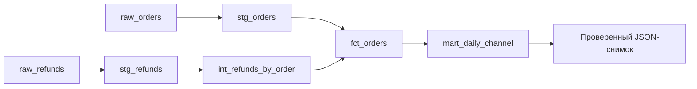

# Конспект: dbt, зерно таблиц и проверяемые витрины

22.10.2026, версия 0.1.0. Новый инструмент — dbt Core 1.12.3; адаптер dbt-duckdb
1.11.0, DuckDB 1.5.0. Запуск описан в README.md, навигация — START_HERE.md.
Проект учебный: он объясняет аналитическое моделирование, а не заменяет рабочее хранилище.

## 1. Задача простыми словами

Магазин хочет узнать выручку по дням и каналам с учётом частичных возвратов.
Есть таблица заказов и таблица возвратов. У заказа одна цена, но возвратов может
быть несколько. Обычное соединение этих таблиц перед суммированием даёт опасную
ошибку: цена заказа повторяется для каждого возврата. Запрос выглядит правдоподобно,
а результат завышен. Это типичная задача дата-инженера: сначала понять единицу
строки, затем соединять данные.

У O0001 цена 10000 копеек. Два события возврата — 2000 и 1000. Правильные показатели:
gross=10000, refunded=3000, net=7000. Если присоединить события напрямую, получится
две строки с ценой 10000; сумма gross ошибочно станет 20000. Наш промежуточный
слой сначала сворачивает возвраты до одной строки на заказ.

## 2. Что изучаем

В предыдущем проекте PostgreSQL отвечал за транзакционную загрузку событий.
Здесь фокус другой: зависимые аналитические SQL-модели, их зерно и проверки.
dbt позволяет описать каждую модель как SELECT. Инструмент компилирует Jinja,
определяет порядок зависимостей, создаёт таблицы или представления и выполняет
проверки данных. Это уменьшает количество собственного кода, управляющего SQL.

Новые понятия: модель, ref, DAG, материализация, generic test и singular test.
DAG — направленный граф без циклов: если B читает A, A должен появиться раньше.
`ref('stg_orders')` одновременно задаёт зависимость и правильное имя relation.
При переименовании схемы не приходится вручную менять все полные имена таблиц.
Однако ref не определяет бизнес-смысл соединения: ответственность за зерно остаётся
у автора SQL. Наличие DAG само по себе не исправляет fan-out.

Использован Python-стек dbt v1 с отдельным адаптером, хотя dbt v2 уже доступен.
Это осознанная закреплённая конфигурация для изучения распространённой модели проекта.
DuckDB работает локально, поэтому не нужны сервер, облачный аккаунт или пароль.

## 3. Контракт данных

`raw_orders` содержит order_id, order_date, channel, status, amount_cents. Одна строка
означает один заказ. ID непустой и уникальный; channel принимает web/store, status —
paid/cancelled. Дата должна преобразовываться в DATE. Денежная сумма — положительное
целое число копеек до 9999999. Валюта учебного примера одна; смешивать валюты нельзя.

`raw_refunds` содержит refund_id, order_id, amount_cents. Здесь строка означает
событие возврата. Уникален refund_id, но order_id повторяется законно. Ссылка должна
указывать на существующий заказ. Возвраты отменённого заказа запрещены, общая сумма
возвратов не превышает его цену. Пустая таблица возвратов допустима. Пустой заказный
набор даёт нулевые денежные итоги; он не является специальной ошибкой: после правильных заголовков получится пустая
витрина; это ограничение текущей политики качества, а не признак реальных продаж.

Генератор создаёт шесть заказов и три возврата из констант. Случайности и сетевого
источника нет. Все имена — технические вымышленные идентификаторы. CSV сохраняются
в игнорируемый workspace и не публикуются. Seeds удобны для маленьких справочников
и примеров; промышленную выгрузку не следует превращать в большой CSV внутри Git.

Суммы raw загружаются как varchar. Проверка регулярным выражением выполняется до
числового CAST: так дробная копейка не превратится в целую округлением. Парсер seeds
может нормализовать представления значений, поэтому это контракт значений таблицы,
а не строгая побайтовая валидация исходного CSV. Для юридически значимого входа нужен
отдельный парсер до dbt с более точными правилами и сохранением оригинальных байтов.

## 4. Архитектура и границы состояния



Staging и intermediate — view: они сохраняют определение запроса. Факт и витрина —
table: готовый результат записывается в файл DuckDB. Пять моделей достаточно,
чтобы видеть отдельные ответственности, не строя многослойную платформу.
`models/schema.yml` содержит стандартные проверки. Запросы tests/*.sql проверяют
бизнес-правила, которые не выражаются одним not_null или unique.

CLI scripts/lab.py готовит данные, вызывает настоящий dbt отдельным процессом и
сохраняет снимок после полного успеха. База, target, логи и последний снимок лежат
в workspace. Профиль находится внутри проекта; параметры дочернего процесса
не изменяют пользовательскую настройку dbt. Автоматическая аналитика отключена.

## 5. Путь строк через SQL

Сначала seeds загружают исходные таблицы. `unique` ищет повтор ключа, `not_null`
проверяет обязательность, `accepted_values` ограничивает статус и канал.
`relationships` проверяет существование заказа для возврата. Затем staging приводит
дату и суммы к типам. Неверная дата приводит к ошибке модели, а не тихому NULL.

Ключевой шаг:

```sql
select order_id, sum(amount_cents) as refunded_cents
from {{ ref('stg_refunds') }}
group by order_id
```

Две строки O0001 превращаются в одну: 3000. У O0004 один возврат 5000. У остальных
заказов строк в этом результате нет. LEFT JOIN сохраняет все заказы, а COALESCE
заменяет отсутствие возврата нулём. У cancelled gross равен нулю; проверка до факта
запрещает присоединить к нему возврат. Факт сохраняет шесть заказов, включая отменённый.
Витрина отбирает paid и группирует по order_date/channel: пять оплаченных заказов
попадают в четыре итоговые строки.

За 01.10 web остаётся только O0001 с net=7000. Отменённый O0003 не увеличивает
ни сумму, ни количество оплаченных. За 02.10 web складываются O0004 и O0006:
30000 + 10000 - 5000 = 35000. Весь набор даёт gross 85000, возвраты 8000, net 77000.
Суммы и счётчики сохраняются целыми; средний чек можно вычислить отдельным полем.

Singular test — SELECT нарушений: ноль строк означает успех. Проверка предела
возврата соединяет агрегат возвратов и заказы. `mart_reconciles` независимо
сравнивает суммарные показатели витрины и факта. Такая сверка ловит потерю строк
между этими слоями, но не доказывает отсутствие одинаковой ошибки в обоих слоях.
Поэтому smoke отдельно сравнивает результат с вручную рассчитанными 77000.

## 6. Повторы, ошибки и восстановление

Используется полный rebuild. Повтор не добавляет строки к старой витрине, а строит
её заново; равенство проверяется по значениям, не по байтам файла БД. Повторённый ID
во входе не считается новым событием и не удаляется молча: unique останавливает
зависимую цепочку. Неизвестный order_id отклоняется relationships. Превышенный
возврат приводит к FAIL бизнес-проверки и SKIP зависимой витрины.

dbt build не является общей транзакцией всех моделей. После отказа часть таблиц
может уже обновиться, а старая mart остаться. Читать такую базу как целостный новый
отчёт нельзя. Перед запуском CLI помечает состояние building; после полного успеха
он читает таблицы, сортирует строки и сохраняет один JSON со статусом success.
При обычном исключении статус становится failed. Принудительное завершение может
оставить building; report также его отвергает.

Fingerprint связывает снимок с именами и байтами CSV, SQL и конфигурации. После
правки входа прежний снимок недействителен до нового успешного build. Состояние
сохраняется заменой соседнего временного файла через os.replace. Это защищает
от частично записанного JSON при обычной ошибке, но не обещает сохранность при
потере питания: fsync и общий журнал транзакций здесь не реализованы. Параллельные
build не поддерживаются. Если другой процесс меняет файл дважды во время обработки,
одной пары сравнений хэша недостаточно для строгой изоляции.

Для восстановления исправь вход и повтори полный build. Удалять прежнюю работу
или вручную чинить SQL-таблицы не требуется. Если используешь dbt напрямую в обход
обёртки, она не узнает об этом как о своём успешном запуске; report остаётся снимком
последнего контролируемого выполнения, а не живым представлением базы.

## 7. Проверка понимания

После prepare/build/report открой CSV, fct_orders.sql и итоговый JSON рядом.
Вычисли результат одного заказа до запуска. Затем измени R0001 с 2000 на 4000:
возвратов станет на 2000 больше, net уменьшится до 75000; gross останется прежним.
Изменение до 20000 должно завершить сборку отказом. Верни 2000 и проверь 77000.

Unittest проверяет безопасность мастерской: запрет перезаписи, обязательный состав
входа, размер, устаревший снимок и запись failed. Это не замена SQL-проверкам.
Smoke запускает девять настоящих dbt build на временных копиях, проверяет ошибки,
повтор и восстановление. Он не изменяет учебные CSV пользователя. Логи отрицательных
сценариев содержат FAIL/SKIP намеренно; ориентируйся на итоговый JSON и exit code.

## 8. Реальные замечания разработки

Первый запуск uv из общего каталога завершился сообщением об отсутствии pyproject;
команда перенесена в собственный корень приложения. Первый dbt build успешно прошёл,
но сообщил о deprecated target-path в YAML. Настройка заменена переменной
DBT_TARGET_PATH в окружении дочернего процесса. Это сохраняет путь target и убирает
зависимость от устаревающей конфигурации. До публикации добавлена отдельная проверка
дробной суммы, поскольку числовое преобразование не должно определять денежную политику.
После изменения типа seed с BIGINT на VARCHAR существующая таблица сохранила
старую схему: regexp получил BIGINT и сборка отказала. Обычный повтор seed очищает
данные, но не обязан менять типы таблицы. Для заявленного полного rebuild добавлен
--full-refresh; CSV при этом не меняются. Другие реальные ошибки фиксируются в VALIDATION. Команда docs сначала получила отказ: --project-dir был передан группе docs,
а нужен подкоманде docs generate. Порядок исправлен, генерация включена в smoke.
Проверка пустого входа выявила NULL в SUM без строк. Добавлен COALESCE до нуля
в снимке и отдельная настоящая сборка пустых seeds в smoke.
Windows считается проверенным только после фактического CI.

## 9. Ограничения и развитие

Нет даты возврата, курсов валют, источника API, incremental, расписания и нескольких
одновременных писателей. Возврат относится к дате заказа: поздний возврат изменит
его историческую когорту. Для кассовой аналитики нужна отдельная дата события и
другая витрина. Для больших объёмов потребуются оптимизация полного rebuild,
контроль актуальности и договорённость об обновлении downstream-отчётов.

## 10. Вопросы и упражнения

Честное представление: «В учебном проекте построил dbt-модели и проверки на DuckDB,
устранил умножение суммы при JOIN и проверил восстановление после плохого входа».

- Зачем ref? Имя relation и ребро зависимости, но не гарантия корректного JOIN.
- Почему unique(order_id) нужен только у orders? У возвратов несколько событий одного заказа допустимы.
- Что означает ноль строк singular test? Нарушений проверяемого условия не найдено.
- Почему одного dbt run мало? Он строит модели; build включает также seeds и проверки.
- Почему успешный один SQL не делает весь отчёт целостным? Другие модели/тесты ещё могут отказать.

Пять упражнений в EXERCISES.md: частичный возврат и 75000; полный и 70000; показать
fan-out; средний net-чек 17500; добавить partner и получить 82000. Перед каждым
изменением запиши зерно, ожидаемое количество строк и суммы, затем проверь их кодом.

## 11. Официальные источники

- [dbt build](https://docs.getdbt.com/reference/commands/build) — порядок ресурсов и тестов.
- [ref](https://docs.getdbt.com/reference/dbt-jinja-functions/ref) — зависимости и relation.
- [Data tests](https://docs.getdbt.com/reference/resource-properties/data-tests) — стандартные утверждения.
- [dbt-duckdb](https://github.com/duckdb/dbt-duckdb) — локальный профиль и адаптер.
- [DuckDB Python](https://duckdb.org/docs/stable/clients/python/overview) — чтение результата.

Выбор зерна, бизнес-смысл даты и стратегия снимка — решения этого приложения;
их нельзя приписывать инструменту как универсальные гарантии.

Публикация исходников и первый CI Ubuntu/Windows выполнены 22 октября.
После добавления проверки пустого набора окончательная версия проходит отдельный
CI; подтверждённые состояния и архив указаны в VALIDATION и журнале серии.
